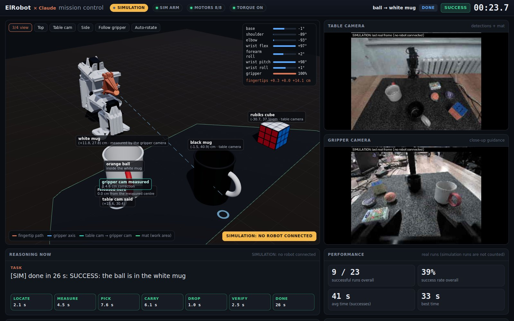
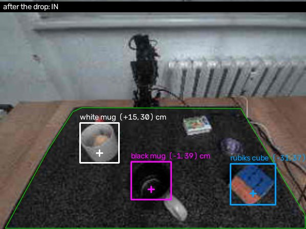
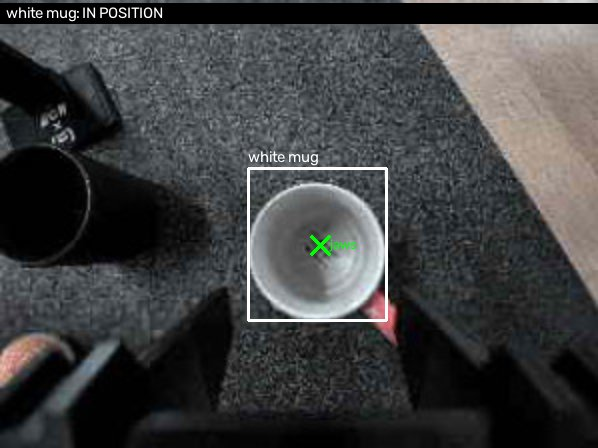
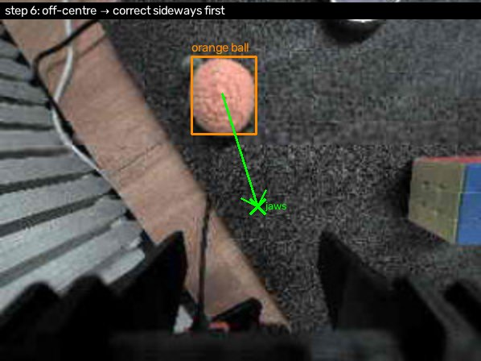
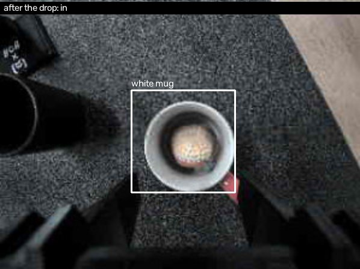
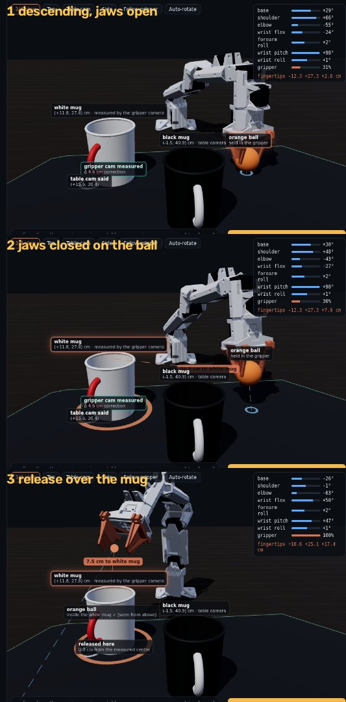

# elrobot-claude

**Claude drives a real robot arm by looking through its cameras.**

You say *"put the orange ball in the white mug"*. Claude finds the ball and the mug with a fixed table camera, uses
the camera on the gripper to measure the mug precisely, picks the ball up, drops it in, and looks into the mug to
check that it really landed. No training data, no scripted positions: the same tools work wherever you put things.

It's an [MCP](https://modelcontextprotocol.io) server for the **NormaCore ElRobot** arm, packaged as a Claude Code
plugin with an operator skill and a live 3D mission control. Built at the CIC Berlin Robotics × AI hackathon
(November 21-22, 2026, NormaCore track).



## Try it in 2 minutes

You need a NormaCore ElRobot with [NormaCore Station](https://github.com/normacore) running on your computer, and
[uv](https://docs.astral.sh/uv/) installed. Then, in Claude Code:

```
/plugin marketplace add kariminem/elrobot-claude
/plugin install elrobot@elrobot
```

Now just talk to it:

```
look at the table and tell me what you see
pick the orange ball
put the ball in the white mug
go home
/elrobot:dashboard
```

No robot? `/elrobot:dashboard sim` opens mission control with a demo run, so you can see how it works first.

## What happens when you ask for something

**1. The table camera finds everything on the work mat.** Objects are recognised with OpenCV (the white mug by its
red handle, the black mug by its white handle, the cube by its stickers) and turned into arm coordinates.



**2. The gripper camera measures what has to be precise.** The table camera is 3 to 6 cm off near the edges of the
mat, which is more than a ball can miss a mug by. So before a drop, the arm hovers over the mug with an empty gripper
and centres it in the gripper camera. That measurement is what the drop uses.



**3. The grasp is guided by the camera, step by step.** Every step is logged with the image, where the ball is
relative to the jaws, and the move it decided on.



**4. It checks the result instead of assuming it.** After the drop it goes back above the mug and looks in. It only
reports SUCCESS if the ball is inside the rim. If it can't tell, it says UNSURE.



## Mission control

`/elrobot:dashboard` (or the `open_dashboard` tool) opens a page on `http://localhost:8893` that shows:

- **A 3D twin of the arm**, built from NormaCore's own 3D model and moved by the real joint readings 10 times a
  second. Drag to rotate, right-drag to pan, scroll to zoom.
- **Every object the cameras found**, with positions held steady against camera jitter. Things it doesn't know
  (a box, a mouse, a phone) appear as blue boxes, and Claude names them from a camera snapshot.
- **The table camera's guess next to the gripper camera's measurement**, so you can see the correction.
- **Both live camera views** with their detections drawn in.
- **The task as it runs:** locate, measure, pick, carry, drop, verify, with the time of each phase and every
  reasoning step as it happens.
- **A chat panel** where you type to Claude and watch it call the same MCP tools.



## Tools

| Tool | What it does |
|---|---|
| `look` | Current images from the table camera and the gripper camera, plus the arm state (fingertip position, gripper opening, joint angles, motor health). |
| `get_state` | Arm state as text only (no images). |
| `move_by` | Move the fingertips by dx/dy/dz centimetres (robot base frame) along a straight line. |
| `move_in_view` | Move relative to what the GRIPPER CAMERA shows (easiest for centring an object between the jaws): right_cm toward the image's right edge, up_cm toward the image's top edge, down_cm straight down (negative = up). |
| `move_to` | Move the fingertips to x/y/z centimetres (z = height above the table). |
| `rotate_joint` | Rotate one joint by a number of degrees (max 45). |
| `set_gripper` | Open/close the gripper: 0 = closed, 100 = fully open. |
| `ready` | Go to the ready pose: fingertips 12 cm above the table, 22 cm in front of the base, pointing down. |
| `pick` | FASTEST way to pick something up (one call, ~20 s): finds the object by colour in the TABLE camera, moves above it, then does the automatic camera-guided grasp and lifts it. |
| `put_ball_on_cube` | Put the orange ball ON TOP of the Rubik's cube: table camera finds the cube, the ball is picked, carried high, the GRIPPER camera confirms/corrects the cube's position from straight above, then the ball is set down 0.5 cm above the top (not dropped). |
| `put_ball_in_mug` | Whole task in one call: hover over the chosen mug with the empty gripper and lock its position with the gripper camera, pick the orange ball, carry it over the mug 4 cm above the rim and drop it (never touches the mug), go home, check with the table camera. |
| `grasp` | AUTOMATIC camera-guided grasp (fast, no step-by-step needed): first move the gripper roughly above the object (within ~5 cm, object visible in the gripper camera, e.g. |
| `place_at` | Carry the held object to x/y cm (table frame), lower it until it almost touches, open the gripper, lift 5 cm. |
| `run_skill` | Run a LEARNED skill (a small neural network trained from human demos): fast and smooth (~20-40 s) but it only knows its one task and does not check its result. |
| `go_home` | Go back to the home (rest) pose: arm folded upright, all motors relaxed, the gripper camera looking forward across the whole table. |
| `open_dashboard` | Open mission control in the browser: a live 3D twin of the arm (driven by its real joint readings), every object the cameras found (unknown ones named by Claude), both camera views with their detections, the step-by-step reasoning and a chat panel. |

Every tool that moves the arm returns both camera images, so the model sees the result of each step before it
decides the next one.

## Use it from other apps

The server is a plain MCP server over stdio, so anything that speaks MCP can use it. Clone the repo first:

```bash
git clone https://github.com/kariminem/elrobot-claude
```

**Claude Desktop or Cursor** (`mcpServers` in their MCP config):

```json
{ "mcpServers": { "elrobot": { "command": "/path/to/elrobot-claude/server/run" } } }
```

**Codex** (`~/.codex/config.toml`):

```toml
[mcp_servers.elrobot]
command = "/path/to/elrobot-claude/server/run"
```

**Just the skill**, for any agent that reads `SKILL.md`:

```bash
npx skills add kariminem/elrobot-claude
```

## Set it up for your own arm

| What | How |
|---|---|
| Which board is the follower arm | `export ELROBOT_FOLLOWER_SERIAL=<board serial>`, or copy `server/config/hardware.env.example` to `hardware.env` |
| Its rest pose | fold the arm into a safe pose, then ask Claude to call `set_home` once |
| Which camera is which | `server/config/camera_roles.json` (the camera queue ids Station shows) |
| The work area | `server/config/mat_roi.json` (mat outline in the table camera) and `TABLE_PX_TO_CM` in `server/tools/vision.py` |

## Safety

The limits live in the tools, not in the prompt:

- Inverse kinematics on NormaCore's URDF: the arm only goes where the model says it can, with a check against
  hitting the desk.
- At most 15 cm per move. A blocked joint stops the move. The gripper squeezes gently and stops on contact.
- `go_home` lifts straight up before folding, so it never sweeps through objects.
- Composite tools report MISSED or UNSURE instead of guessing a success.

Keep a hand near the arm's power switch the first time you let it move.

## How it fits together

```
you ──▶ Claude ──MCP──▶ server/tools/elrobot_mcp.py       16 tools
          ▲                       │
          │                       ▼
          │              arm_control.py                   inverse kinematics, safety checks
          │              vision.py                        OpenCV detection, both cameras
          │                       │
          │                       ▼
          └── images ◀── NormaCore Station ──▶ 8 servos + 2 cameras
```

`server/run` starts the server with its Python packages (numpy, OpenCV, Pillow) through uv. To use your own Python
instead, set `ELROBOT_PYTHON`.

## Updating

It's a normal Git repo. Plugin users get new versions with `/plugin update elrobot`; everyone else with `git pull`.

## Credits and license

MIT, see `LICENSE`. Includes NormaCore's Station Python client, message code and the ElRobot URDF and meshes from
[norma-core](https://github.com/normacore), under their MIT license (`server/vendor/norma-core/LICENSE`).
The 3D view uses [three.js](https://threejs.org) (MIT).
